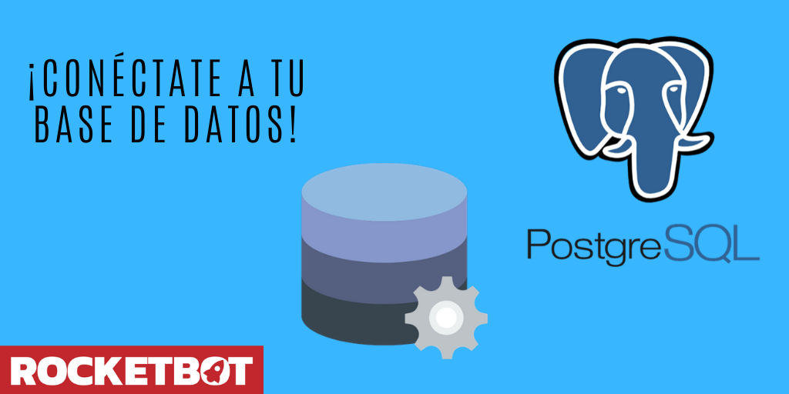

# PostgreSQL
  
Modulo para conectarse a una DB PostgreSQL  

*Read this in other languages: [English](Manual_PostgreSQL.md), [Português](Manual_PostgreSQL.pr.md), [Español](Manual_PostgreSQL.es.md)*
  

## Como instalar este módulo
  
Para instalar el módulo en Rocketbot Studio, se puede hacer de dos formas:
1. Manual: __Descargar__ el archivo .zip y descomprimirlo en la carpeta modules. El nombre de la carpeta debe ser el mismo al del módulo y dentro debe tener los siguientes archivos y carpetas: \__init__.py, package.json, docs, example y libs. Si tiene abierta la aplicación, refresca el navegador para poder utilizar el nuevo modulo.
2. Automática: Al ingresar a Rocketbot Studio sobre el margen derecho encontrara la sección de **Addons**, seleccionar **Install Mods**, buscar el modulo deseado y presionar install.  

## Como usar este módulo
Para usar este módulo, tienes que tener una base de datos (en la nube o on-premise) ya creada.

## Descripción de los comandos

### Conectar BD
  
Conectarse a una BD PostgreSQL
|Parámetros|Descripción|ejemplo|
| --- | --- | --- |
|Hostname|IP o dominio del servidor|localhost|
|Port|Puerto de conexión al servidor|5432|
|Usuario|Usuario de la base de datos|username|
|Contraseña|Contraseña del usuario de la base de datos|******|
|Base de datos|Nombre de la base de datos a conectar|test|
|SSL|Marcar si la conexión requiere SSL||
|Asignar a variable|Variable en la cual contener el resultado de la conexión|Variable|

### Ejecutar una query
  
Ejecuta una query hacia la bd PostgreSQL
|Parámetros|Descripción|ejemplo|
| --- | --- | --- |
|Query|Query que se desea ejecutar en la base de datos|SELECT * from table|
|Asignar resultado a variable|Variable en la cual contener el resultado del query|Variable|

### Cerrar Conexión
  
Cierra la conexión a la BD PostgreSQL
|Parámetros|Descripción|ejemplo|
| --- | --- | --- |
||||
