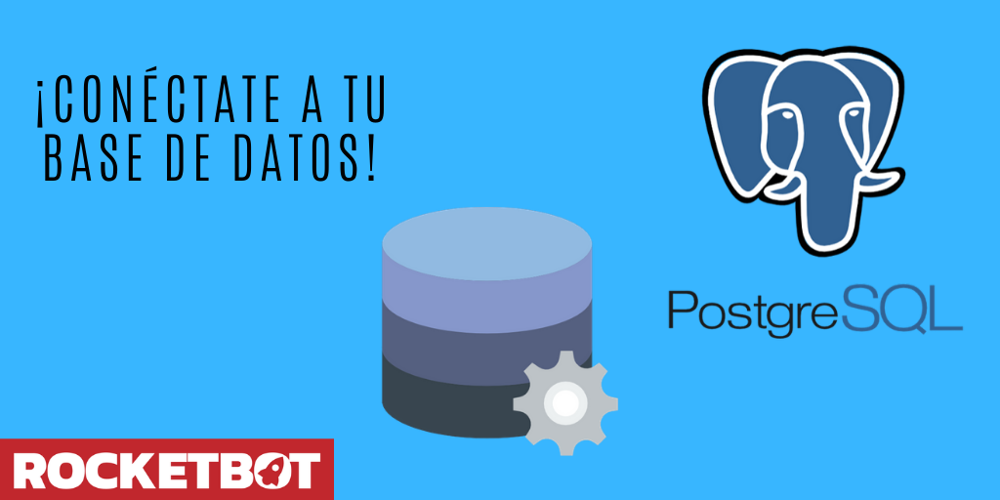

# PostgreSQL
  
Module to connect to a PostgreSQL DB  

*Read this in other languages: [English](Manual_PostgreSQL.md), [Português](Manual_PostgreSQL.pr.md), [Español](Manual_PostgreSQL.es.md)*
  

## How to install this module
  
To install the module in Rocketbot Studio, it can be done in two ways:
1. Manual: __Download__ the .zip file and unzip it in the modules folder. The folder name must be the same as the module and inside it must have the following files and folders: \__init__.py, package.json, docs, example and libs. If you have the application open, refresh your browser to be able to use the new module.
2. Automatic: When entering Rocketbot Studio on the right margin you will find the **Addons** section, select **Install Mods**, search for the desired module and press install.  

## How to use this module
In order to use this module, you need to have a database (cloud or on-premise) already running.

## Description of the commands

### Connect DB
  
Connect to PostgreSQL DB
|Parameters|Description|example|
| --- | --- | --- |
|Hostname|IP or domain of the server|localhost|
|Port|Port of conection to the server|5432|
|Username|User of the database|username|
|Password|Password of the user|******|
|Database|Database name to conect|test|
|SSL|Check if the connection requires SSL||
|Assign to variable|Variable where to store database conection status|Variable|

### Execute a query
  
Execute query
|Parameters|Description|example|
| --- | --- | --- |
|Query|Query to exceute in the database|SELECT * from table|
|Set result to var|Variable where to store query result|Variable|

### Close Connection
  
Close connection to PostgreSQL DB
|Parameters|Description|example|
| --- | --- | --- |
||||
