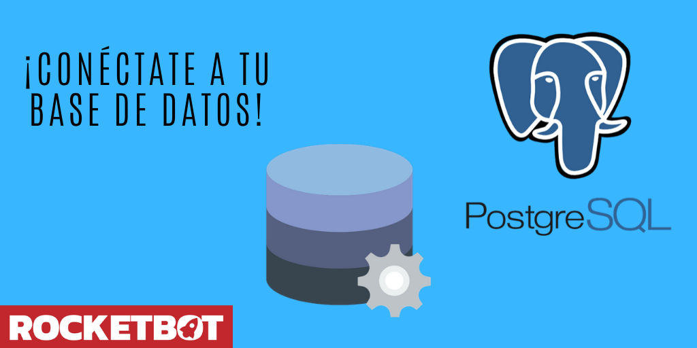

# PostgreSQL
  
Módulo para conectar a um DB PostgreSQL  

*Read this in other languages: [English](Manual_PostgreSQL.md), [Português](Manual_PostgreSQL.pr.md), [Español](Manual_PostgreSQL.es.md)*
  

## Como instalar este módulo
  
Para instalar o módulo no Rocketbot Studio, pode ser feito de duas formas:
1. Manual: __Baixe__ o arquivo .zip e descompacte-o na pasta módulos. O nome da pasta deve ser o mesmo do módulo e dentro dela devem ter os seguintes arquivos e pastas: \__init__.py, package.json, docs, example e libs. Se você tiver o aplicativo aberto, atualize seu navegador para poder usar o novo módulo.
2. Automático: Ao entrar no Rocketbot Studio na margem direita você encontrará a seção **Addons**, selecione **Install Mods**, procure o módulo desejado e aperte instalar.  

## Descrição do comando

### Conectar BD
  
conectar a um DB PostgreSQL
|Parâmetros|Descrição|exemplo|
| --- | --- | --- |
|Hostname|IP ou domínio do servidor|localhost|
|Port|Porta de conexão ao servidor|5432|
|Usuário|Usuário da base de dados|username|
|Senha|Senha do usuário da base de dados|******|
|Base de dados|Nome da base de dados para conectar|test|
|SSL|Marque se a conexão requer SSL||
|Atribuir a variável|Variável onde armazenar o status da conexão com a base de dados|Variable|

### Executar uma query
  
Executa uma query para o banco de dados PostgreSQL
|Parâmetros|Descrição|exemplo|
| --- | --- | --- |
|Query|Query a ser executada no banco de dados|SELECT * from table|
|Atribuir resultado para var|Variável onde armazenar o resultado da query|Variable|

### Fechar Conexão
  
Fecha a conexão com o banco de dados PostgreSQL
|Parâmetros|Descrição|exemplo|
| --- | --- | --- |
||||
